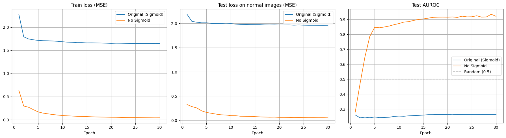
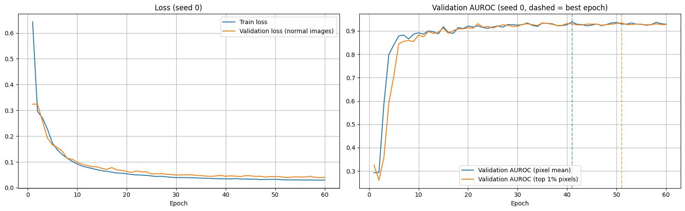
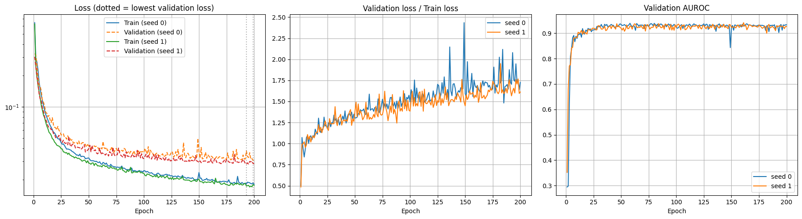

# 제조업 실시간 이상 탐지 시스템 구축 실습

VisA 데이터셋(pcb4)으로 정상 이미지만 학습해 불량을 찾는 이상 탐지 실습이다. PaDiM, CNN AutoEncoder, One-Class SVM 세 모델을 비교하고, PaDiM으로 Gradio 웹 검사 화면을 만든다.

## 파일

| 파일 | 내용 |
|---|---|
| **`제조업_이상탐지_실습_합본.pdf`** | 노트북(1\~54쪽, 실행 결과 포함) → Gradio 실행 결과(55\~57쪽) → 개인 회고(58\~61쪽) 순서로 합친 PDF |
| `이상탐지_직접해보기.ipynb` | 과제 원본 코드를 흐름 21개로 묶고, 흐름마다 코드 설명·생각해 볼 점·내 코멘트를 붙인 노트북 (코랩 Pro, T4 GPU 실행 결과 포함) |
| `report/개인회고.md`, `report/개인회고.pdf` | 개인 회고 |
| `report/Gradio_실행결과.md` | Gradio 웹 화면에 테스트 사진 4장을 올려 본 결과와 캡처 |

## 실행 환경

- Google Colab Pro, T4 GPU, Python 3.13 (10/13에 추가한 개인 실험은 T4가 할당되지 않아 L4 GPU에서 실행)
- 원본 코드에서 바꾼 곳은 `# !pip install wget`의 주석을 푼 한 줄뿐이다. 원본에 없는 셀은 첫 줄에 `[개인 실험]`이라고 표시했다.

## 결과 (pcb4, 테스트 301장 중 불량 100장)

| 모델 | AUROC | AUPRC | Best F1 |
|---|---|---|---|
| PaDiM | 0.962 | 0.900 | 0.872 |
| One-Class SVM | 0.824 | 0.714 | 0.667 |
| CNN AutoEncoder | 0.264 | 0.226 | 0.525 |

- PaDiM을 시드 5개로 다시 돌린 AUROC: **평균 0.960 ± 0.004** (0.954\~0.964) → 위 0.962는 믿을 만한 수치
- AutoEncoder에서 마지막 Sigmoid만 뺀 구조(30에폭): AUROC **0.26 → 0.92** (개인 실험, 아래 러닝 커브)
- 그 구조를 최적화(60에폭, 검증 AUROC로 최적 에폭 선택, 최종 테스트 1회)하고 시드 5개로 반복: 최종 테스트 AUROC **0.935 ± 0.006** (테스트셋 절반 151장 기준)
- 같은 최종 테스트 151장으로 PaDiM도 시드 5개 평가: **0.977 ± 0.003** → 같은 조건에서도 PaDiM이 가장 좋다

## 개인 실험

- **AutoEncoder 러닝 커브 + before/after**: 에폭마다 학습 loss·테스트 정상 loss·테스트 AUROC를 기록했다. 원본 구조는 학습 loss가 2.28 → 1.65로 계속 줄었지만 AUROC는 30에폭 내내 0.25\~0.27이었다(loss만 보면 착각한다). Sigmoid만 빼자 AUROC가 0.92까지 올라 원인이 구조였음을 확인했다. 30에폭까지 테스트 loss가 계속 줄어 과적합 지점은 아직 없다. 테스트셋은 관찰용으로만 쓰고 에폭 선택에는 쓰지 않았다.
- **PaDiM 시드 5개**: 평균 0.960 ± 0.004로, 무작위 요소가 있어도 결과가 안정적이다.
- **AutoEncoder 최적화 + 시드 평균**: 테스트셋을 검증용/최종 테스트용으로 반씩 나눠(불량 비율 유지) 검증 AUROC로 최적 에폭을 고르고 최종 테스트는 한 번만 쟀다. 시드 5개 결과 0.935 ± 0.006, 고른 에폭은 26\~53. 60에폭까지 과적합은 나타나지 않았고 검증 AUROC는 20에폭 전후부터 평평했다. 이상 점수를 상위 1% 픽셀 평균으로 바꾸면 0.933 ± 0.013으로 나아지지 않았다.
- **과적합 시점 확인(200에폭, 시드 0·1)**: 검증 loss는 거의 끝까지 줄어 최저가 199에폭(0.03052)·193에폭(0.02806)으로, loss 기준 과적합은 200에폭 안에 나타나지 않았다. 검증÷학습 loss 비율은 10에폭 1.092·1.018 → 200에폭 1.726·1.612로 계속 벌어졌다. 검증 AUROC는 30에폭 이후 0.92\~0.94에서 멈춰(최고 58에폭 0.9388, 161에폭 0.9414) 실질적인 최적 구간은 30\~60에폭이다.
- 카테고리별 불량 비율: 12개 카테고리 모두 불량 100장, 불량 비율 9\~17%(전체 11.1%)
- PaDiM이 틀린 이미지: 실제 정상인데 불량으로 판정된 사진(기울어진 기판 포함)과 임계값 바로 아래의 불량 사진 → 임계값 하나로 완벽히 나눌 수 없다
- 웹 판정 기준(임계값 15) 검증: 실제 불량은 100% 잡지만 실제 정상의 67.2%를 불량으로 판정 → 임계값을 데이터로 다시 정해야 한다
- **임계값을 검증 데이터로 정하기**: 검증 F1 최고 임계값 22.13 → 최종 테스트 151장에서 재현율 98.0%, 정밀도 84.5%, 오탐 9/101장, 미탐 1/50장 (15일 때는 재현율 100%, 정밀도 40.3%, 오탐 74/101장)
- Gradio 테스트(원본 임계값 15): 평범한 정상·기울어진 정상·경계선 불량·확실한 불량 4장 모두 비정상으로 판정 → 불량은 다 잡지만 정상도 불량으로 판정한다

