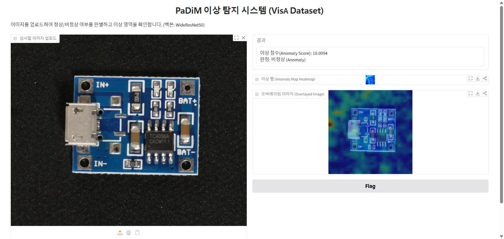
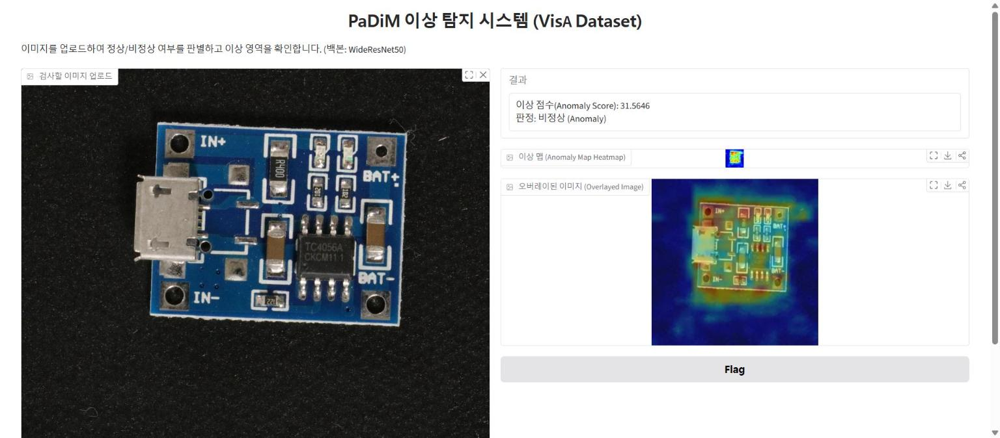
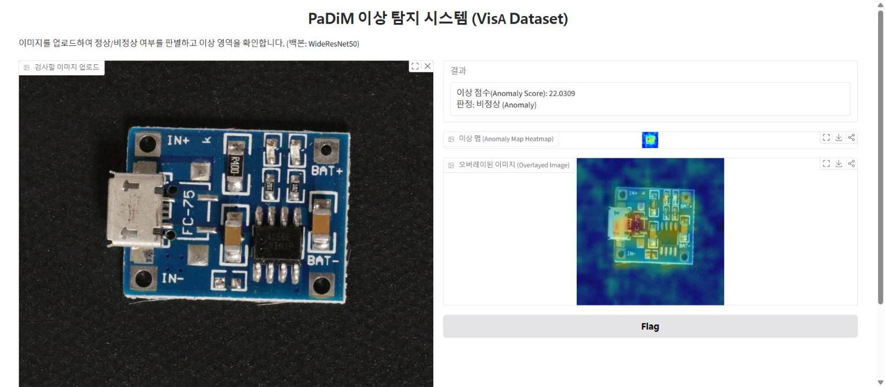
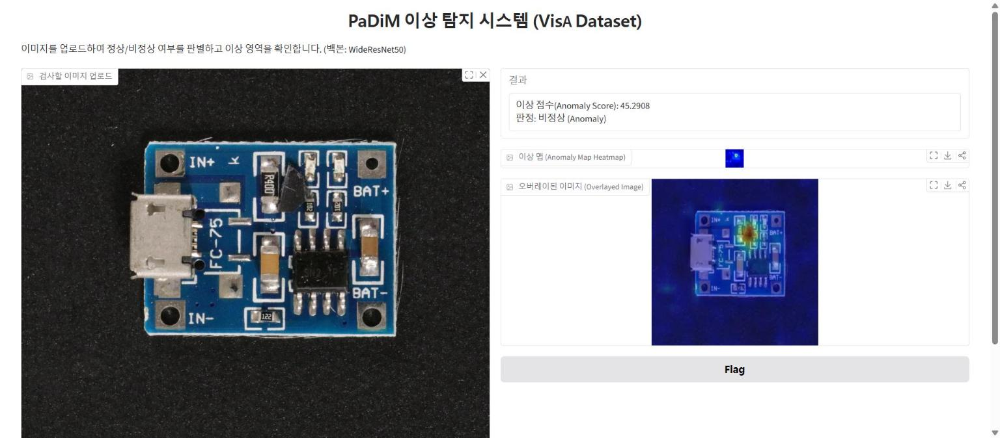

# Gradio 실행 결과

흐름 21의 원본 코드(`iface.launch(share=True)`, 판정 기준 임계값 15)로 띄운 웹 화면에 테스트 사진 4장을 올려 봤다. ②③은 흐름 15 개인 실험에서 PaDiM이 틀렸던 사진이고, ①④는 비교용으로 고른 사진이다(① 실제 정상 중 점수가 중간인 사진, ④ 실제 불량 중 점수가 가장 높은 사진).

| # | 사진 | 실제 정답 | Gradio 결과 | 맞았나 | 히트맵에서 보이는 것 |
|---|---|---|---|---|---|
| ① | 평범한 정상 (`Normal/0821`) | 정상 | 18.10점 → 비정상 | ❌ 오탐 | 빨간 부분이 기판이 아니라 왼쪽 배경에 있다 |
| ② | 기울어진 정상 (`Normal/0859`) | 정상 | 31.56점 → 비정상 | ❌ 오탐 | 노랗고 빨간 부분이 기판 테두리를 따라 나타난다 |
| ③ | 경계선 불량, 부품 누락 (`Anomaly/046`) | 불량 | 22.03점 → 비정상 | ✅ | 왼쪽 가운데 부품 근처에 빨간 점이 있다 |
| ④ | 확실한 불량, 이물질 (`Anomaly/028`) | 불량 | 45.29점 → 비정상 | ✅ | 검은 이물질 위치가 빨갛게 나온다 |

- 임계값이 15라서 4장 모두 비정상으로 판정됐다. 실제 불량은 다 잡지만 실제 정상도 불량으로 판정한다. 흐름 20 개인 실험의 "실제 정상의 67%를 불량으로 판정"을 웹 화면에서 직접 확인한 셈이다.
- ③은 흐름 15 개인 실험(임계값 22.26)에서는 놓친 사진인데, 임계값 15에서는 잡혔다. 대신 ①②처럼 실제 정상도 같이 걸린다. 재현율과 정밀도가 서로 맞바뀌는 관계가 그대로 보인다.
- ④처럼 결함이 뚜렷하면 히트맵이 그 위치를 정확히 가리킨다. ②의 테두리 패턴은 기울기 때문이라는 추정과 맞지만 확정은 아니다.
- "이상 맵" 칸의 히트맵은 28×28 지도를 키우지 않고 그대로 내보내서 아주 작게 보인다.
- 코랩 런타임이 끊겨서 파트 D(PaDiM 학습)를 다시 실행한 뒤 테스트했다. 그래서 이 점수는 노트북의 개인 실험 셀과 같은 방법으로 새로 학습한 모델의 점수다.

### ① 평범한 정상 → 비정상 (오탐)

### ② 기울어진 정상 → 비정상 (오탐)

### ③ 경계선 불량 → 비정상

### ④ 확실한 불량 → 비정상

